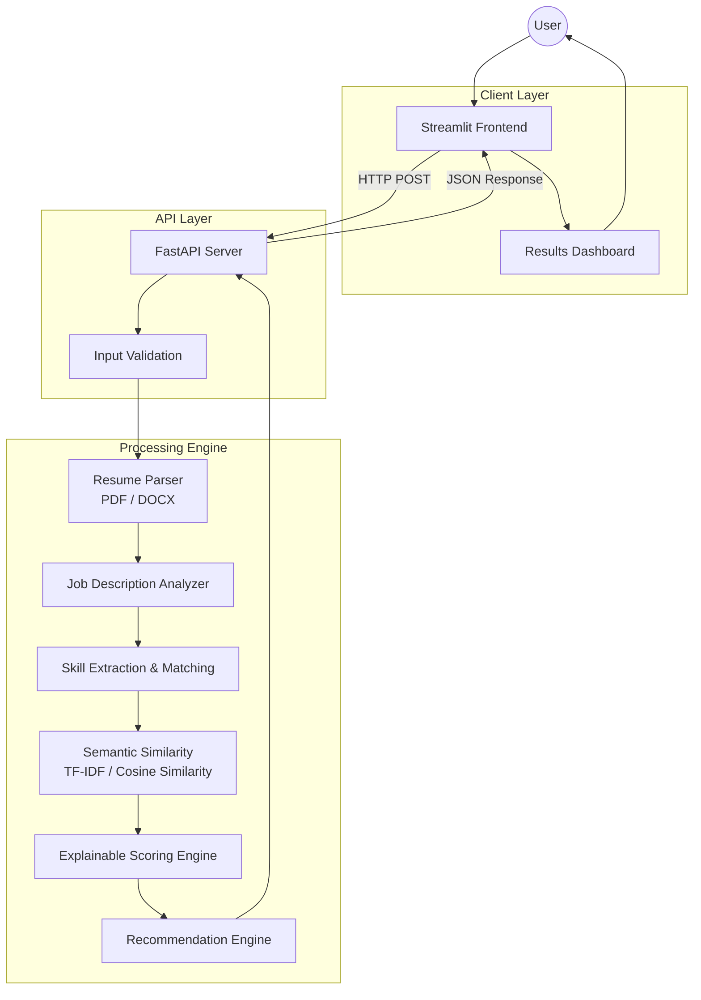

## Architecture

The application uses a modular client-server architecture. Streamlit
provides the user interface, while FastAPI handles document processing,
NLP analysis, scoring, and recommendations.

### Architecture Diagram

### Processing Workflow

1. **Resume Upload:** The user uploads a PDF or DOCX resume through Streamlit.
2. **API Validation:** FastAPI validates the uploaded file and job description.
3. **Text Extraction:** The resume parser extracts text from the document.
4. **Job Analysis:** The system identifies relevant skills and job requirements.
5. **Skill Matching:** Resume skills are classified as exact matches, related skills, or missing requirements.
6. **Semantic Analysis:** TF-IDF and cosine similarity measure textual similarity.
7. **Score Calculation:** The scoring engine calculates an explainable compatibility score.
8. **Recommendations:** The recommendation engine identifies gaps and suggests truthful improvements.
9. **Results Presentation:** FastAPI returns structured results, which Streamlit displays to the user.

The backend is the single source of truth for analysis and scoring. The frontend communicates with the backend through HTTP requests.
